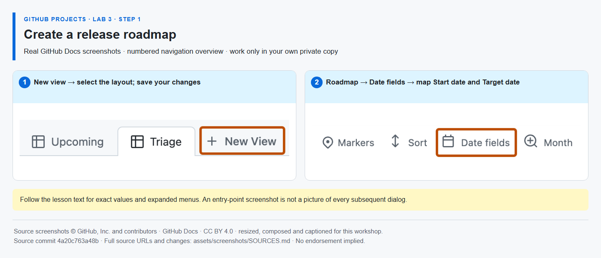
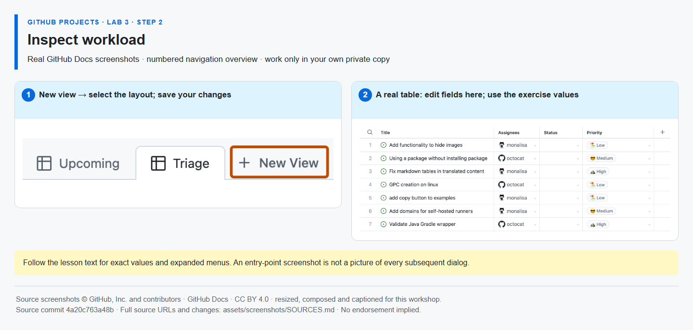
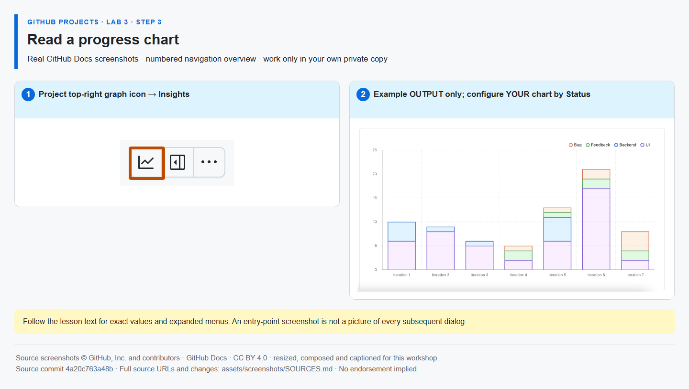
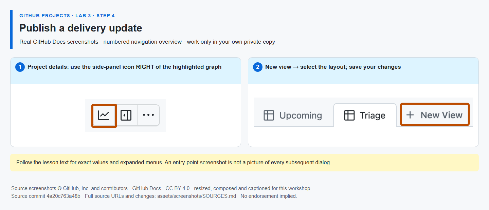

# GitHub Projects — Lab 3: visualize and communicate

All participation uses the GitHub website in your browser.

## Step 1 — Set up your release roadmap

**Time: 20 minutes · Topic: a private workspace, two work issues and roadmap dates**

### Welcome

- **Who is this for?** Project managers, product owners, team leads and developers, either continuing the full workshop or choosing only Lab 3.
- **What will you learn?** Roadmap dates, workload grouping, current Insights charts, native Project status updates and a private reporting snapshot.
- **What will you build?** A saved release roadmap, workload view and progress chart, plus an At risk update and browser-downloaded TSV.
- **How long?** Optional standalone: **45 minutes** (20 + 8 + 7 + 10). Full-workshop continuation: **35 minutes** (10 + 8 + 7 + 10), because the workspace already exists.
- **Prerequisites:** your own GitHub account, a browser, permission to create a private repository and private Project, and access to Project fields, Roadmap, Insights and status updates. No instructor account, personal access token or App is needed. If a required native feature is unavailable, resolve access or leave the lab incomplete.

### Start here — choose one path

- **Attending all three labs?** Stay in your existing private [Lab 1](https://github.com/alvine-aurelio-org/bsp-github-projects-lab-1) copy, the **same Mona exercise issue and same Project**. Follow Mona's Lab 3 comments there for the **35-minute continuation**, not this standalone setup. Keep your five existing work issues, including Lab 2's completed implementation and open verification in Sprint 2; do not duplicate them. **No other copy is needed.**
- **Optional standalone: practising only Lab 3?** On this Lab 3 source, select **[Use this template](https://github.com/alvine-aurelio-org/bsp-github-projects-lab-3/generate) → Create a new repository**, choose yourself as owner, select **Private**, and create the copy. Use **one private repository and one private Project** for this chosen lab; you do not need three copies. **Already in your private copy? Skip the template button.**
- In that private copy, open **Issues → Mona's GitHub Projects Lab 3 — start here**. Mona creates **only one exercise issue**, never the work issues. If it has not appeared, open **Actions → Mona — guided laboratory → Run workflow → main** once, then recheck Issues. Do not start a second exercise. All later instructions, answers and check feedback stay in this **same Mona exercise issue**; always post a **new comment**, not an edited answer or a work-issue comment. Public source repositories are inert: do not answer or run the exercise there.

**Why:** a Roadmap places work on a timeline to discuss timing and overlap. It is not automatic scheduling or a cross-Project portfolio roll-up.

**How:** set up two synthetic delivery issues in the browser, then map their actual date cells to a saved Roadmap view.

**Do — standalone setup, after your private copy and Mona exercise exist:**

1. For a personally owned repository, open your profile → **Your projects → New project → Table**. If the repository belongs to an approved organization, use **that organization's Projects tab → New project → Table** instead. Name the Project, keep its visibility **Private** in Project settings, and use the **same owner as your repository**. Name the table **Backlog**. In your private repository, open **Projects → Link a project** and select it. Keep Mona's issue and the Project in separate browser tabs.
2. In your private repository's **Issues → New issue**, create **only two work issues**, using only the **Exact issue title** column below for their titles. Create both yourself **after Mona's exercise was opened**, and add each to your Project using its **Projects** sidebar. These are native repository issues, not draft Project rows. Do not add Mona's exercise issue to the Project.

| Work role      | Exact issue title                                   | Effort | Assignees  | Status | Sprint   |
| -------------- | --------------------------------------------------- | -----: | ---------- | ------ | -------- |
| Implementation | [Workshop] Publish the service release checklist    |      3 | Yourself   | Done   | Sprint 1 |
| Verification   | [Workshop] Verify the release checklist in Sprint 2 |      2 | Unassigned | Todo   | Sprint 2 |

3. In Backlog, select the rightmost column-header **+ (Add field) → Add field** (older layouts say **New field**) to open **Create a project field**. Create **Effort**, type **Number**, and enter **3** and **2**. Assign implementation to yourself, leave verification **unassigned**, and set their Project **Status** to **Done** and **Todo** respectively. Verification must remain **open**. Implementation may be **open** or **closed as completed** using the issue UI. The built-in **Item set to Done** workflow may close implementation automatically; inspect its actual issue state. Its Done status is **manual demo data, not evidence of a PR merge**.
4. Create or reuse **Sprint**, type **Iteration**. Set **Starts on** to today or your agreed sprint start this week and explicitly choose a **one-week** duration. In **… → Settings → Sprint**, name the first two consecutive, non-overlapping iterations **Sprint 1** and **Sprint 2**. Check the actual start/end dates: each covers seven days, and Sprint 2 starts the day after Sprint 1 ends. Do not assume Monday starts or copy screenshot dates. Put implementation in Sprint 1 and verification in Sprint 2.
5. In Backlog, use **+ (Add field) → Add field** (sometimes **New field**) to create **Start date** and **Target date**, both type **Date**. Enter actual date values within the Sprint windows you just checked: implementation within Sprint 1, verification within Sprint 2, each start on or before its target. Reuse correctly typed fields rather than duplicating them.
6. Select **New view → Roadmap**, name it **Release roadmap**, and open **Dates** (shown as **Dates: Start date and Target date** after mapping; some layouts call it **Date fields**) to select **Start date** and **Target date**. Under **Markers**, show **Sprint** iteration markers. Clear inherited filters and **Save** the view without a filter hiding Done or closed implementation; confirm both bars appear.

**Expected result:** one private Project linked to your private repository, exactly two manually created work issues, and two timeline bars with meaningful dates and Sprint markers. Done implementation is demonstration data, not a claim that code was delivered.



_Navigation reference: this inherited overview locates date mapping, not every setup dialog or your own dates. [Image sources and modifications](assets/screenshots/SOURCES.md)._

**Complete in the same Mona exercise:** Open your Project, copy the URL from the address bar, and paste only that link as a new comment below. Do not add a command, label or explanation.

**MIXED EVIDENCE:** Mona checks and binds the two native work issues; your Project setup and roadmap are self-confirmed.

## Step 2 — Inspect workload

**Time: 8 minutes · Topic: ownership gaps and relative effort**

**Why:** grouping by Assignees reveals ownership and unassigned work; summing Effort compares relative size. Neither calculates available hours, leave, cost or actual capacity.

**How:** group an open-issue Table view, then make the ownership gap visible before assigning verification to yourself.

**Do:**

- Create a **Table** view named **Workload**. Clear inherited filters, then filter to **open** issues with `is:open`. This filters native issue state, not Project Status: implementation appears if you left its issue open, even when Status is Done.
- In **View** settings beside the search bar, choose **Group by → Assignees**. Show **Effort** and **Sprint**, and set **Field sum → Effort** (sometimes **Sum of**). This menu is multi-select: clear **Count** if selected so the displayed total is effort, not the number of items. Save the view.
- Find **verification #{{ISSUE_verification}}** in the unassigned group with Effort **2**. Assign it to yourself and observe it move to your group. Keep its **Sprint 2** assignment; no instructor or other participant is needed.

**Expected result:** a saved open-work view grouped by assignee, with an owner for verification. Standalone uses only the two actual issues created in Step 1; the all-three-lab path retains its five existing issues. Do not create extra issues or hide unassigned work to improve the result.



_Navigation reference: this table overview does not show the expanded Group by menu; use the settings above. [Image sources and modifications](assets/screenshots/SOURCES.md)._

**Complete in the same Mona exercise:**

```text
/done 3-2
```

**SELF-CONFIRMED:** you confirm the grouping, open filter, effort sum and ownership change. Mona does not inspect Project workload or capacity.

## Step 3 — Read a progress chart

**Time: 7 minutes · Topic: current Insights and honest interpretation**

**Why:** a current chart shows today's distribution of Project items. One workshop session cannot establish historical velocity, burn-down or a multi-week trend.

**How:** configure a current Status item-count chart in native Project Insights.

**Do:**

- Open your Project's **Insights** graph icon near the top-right. Choose **New chart → Configure**.
- Name it **Delivery status**, choose **Column** layout, X-axis **Status**, Y-axis **Count of items**, clear unnecessary filters, and save. Use item count, not Effort.
- Inspect the actual categories. Ask: which Status contains the most items, and why is task count different from remaining effort? In standalone, the two issue rows initially contribute **one Done and one Todo**; the full-workshop Project has five planned issue rows and may differ. Implementation's manual Done status does not establish a PR merge, and a PR is not an extra planned issue.

**Expected result:** a saved current chart named Delivery status, interpreted using your Project's real Status values. If Insights is unavailable, do not claim a chart exists; resolve access or record this lab as incomplete.



_Navigation reference: the example chart is by iteration, not the required Status configuration. It illustrates the output only; use the axes specified above. [Image sources and modifications](assets/screenshots/SOURCES.md)._

**Complete in the same Mona exercise:**

```text
/done 3-3
```

**SELF-CONFIRMED:** you confirm creating and interpreting the chart. Mona calls no chart API and does not grade the image. An optional ordinary comment may explain your interpretation.

## Step 4 — Publish a delivery update

**Time: 10 minutes · Topic: native Project health and a private reporting snapshot**

**Why:** a native Project status update explains the risk behind the counts. Its target date describes project delivery, not each task's due date. A TSV is a point-in-time snapshot; the Project remains the source of truth.

**How:** publish a native health update and use the browser's view-data export, without changing repository files.

**Do:**

- Open the Project's top-right **Project details** side panel. Under **Status updates**, select **Add update**. Choose **At risk**, set a target date after Sprint 2, write the following synthetic update, and select **Save update**. Use the native status-update feature, not an issue comment or a custom field:

  > **Risk:** checklist verification is unfinished.<br>
  > **Mitigation:** the verification task has an owner and is planned for Sprint 2.<br>
  > **Next action:** verify the published checklist before the target date.

- Return to **Backlog**, clear filters and show **Title, Status, Assignees, Effort and Sprint**. Confirm all rows are loaded: **two issue rows for standalone**, or **five existing issue rows for the all-three-lab path**, including closed implementation. Save any view changes. Do not export the filtered Workload view, create duplicate issues or include Mona's exercise issue to change the count.
- Open **View** settings → **Export view data**, check the confirmation dialog's row count, then select **Export** in that dialog. Opening the dialog alone does not download the TSV. Keep the **TSV locally** and open your browser's own **downloads panel** to confirm a **completed TSV download**, not a pending, blocked or cancelled entry. No file editing, separate application or upload is needed. Confirm the saved update is visible in the Project. **Do not commit, upload or attach the export or account screenshots** to any repository or issue. Keep verification open; do not close unfinished work to improve a chart.

**If the download is missing:** bring the GitHub Project tab to the foreground, check the browser's download notice and downloads panel, and retry the export only if no completed file exists. Respect managed download restrictions. If downloading remains unavailable or cannot be confirmed, leave this activity incomplete and **do not submit `/done 3-4`**. A saved update or a closed export dialog is not download evidence.

**Expected result:** a saved native At risk update with mitigation and target date, and a local-only TSV matching the unfiltered saved view. The same one private repository and one private Project remain in use.



_Navigation reference: Add update and Export view data are described above; the overview is not an invented expanded dialog or evidence of your export. [Image sources and modifications](assets/screenshots/SOURCES.md)._

**Complete in the same Mona exercise:**

```text
/done 3-4
```

**SELF-CONFIRMED:** you confirm saving the native update, checking the unfiltered view and downloading its TSV. Mona does not read the update or exported file. It posts a recap distinguishing native issue binding from self-confirmed Project work, then closes **only the exercise issue**. Verification remains open for Sprint 2.

## Troubleshooting and evidence FAQ

- **Which path should I use?** All-three-lab attendees follow the existing Lab 1 Mona comments without another copy or repeated setup. Standalone learners use only this Lab 3 template and its single exercise. `/status` and `/help` are safe in the active private exercise.
- **What does the first link prove?** Mona finds the two native issues by exact title, checks their actual IDs, learner authorship and creation after the exercise, then binds those IDs. Verification must be open; implementation may be open or closed as completed. All Project work is **self-confirmed**, including existence, private visibility, access, repository link, membership, fields, views, charts, updates and export. Mona uses **no Projects API** and does not grade screenshots.
- **No Mona in my copy:** confirm the repository is private, not itself a template, and uses main. Inspect its Actions result and existing Issues before running the start workflow once. Do not create another exercise, edit bot progress or post in a public source.
- **A roadmap bar is absent:** check both date cells against the actual iteration start/end dates, start-before-target ordering, the **Dates** / **Date fields** mapping, and view filters, especially a filter hiding closed implementation.
- **Workload looks empty or totals differ:** clear inherited filters, use `is:open`, confirm Effort is numeric, show unassigned work, and keep verification's Effort 2 and Sprint 2. **Field sum** is multi-select; choose Effort and clear Count if you want only the effort total. Count and effort are different measures. An implementation issue closed by the default Done workflow is correctly absent from this open-issue view, but must remain in unfiltered Backlog and Roadmap.
- **Insights or status updates are missing:** check Project access, account policy and entitlement. Do not substitute a spreadsheet or issue comment for the required native UI activity, claim API verification, or self-confirm unavailable work.
- **Export view has fewer rows:** return to unfiltered Backlog, load all rows and check membership: two planned issues in standalone, five in the full workshop. Check that count in the export confirmation, then select Export. A completed entry in the browser's own downloads panel is required before the final command; a clicked button or timeout is not proof. If the export control or browser download fails, leave that activity incomplete; do not substitute an upload or claim file-content verification.
- **Mona rejects an answer:** Step 1 accepts only the Project address-bar link. Later steps use their exact `/done` command as a new comment from the learner who started the same private exercise. Do not edit bot progress or answer in a public source.

## Safety and evidence

Use synthetic training tasks only, never real BSP data or original BSP documents. The initial native work-issue binding is repository-verified; every Project activity is self-confirmed, not API-verified, AI-graded or independently assessed. Keep browser-downloaded TSV exports and account screenshots private. Browser sign-in and the built-in repository workflow token are sufficient; no participant secret, instructor provisioning or deployed service is needed.

## Author verification

**Maintainers only:** [package.json](package.json) defines the dependency-free Node test and [content verification](tools/verify-content.mjs) scripts; CI uses **Node 24**. Checks require the four real PNGs, resolved local links, schema-v3 metadata and matching immutable runtime pins. Unresolved pins are a publication blocker. These offline checks are not learner instructions or a live UI rehearsal.

## License and acknowledgements

Workshop text and code: [MIT](LICENSE). Reused GitHub Docs screenshot material is separately [CC BY 4.0](https://creativecommons.org/licenses/by/4.0/); see [THIRD-PARTY-NOTICES.md](THIRD-PARTY-NOTICES.md) and [image sources](assets/screenshots/SOURCES.md). Inspired by [GitHub Skills](https://skills.github.com/), but independently authored, not an official GitHub Skills course and not endorsed by GitHub or BSP. [Security and privacy](SECURITY.md).
